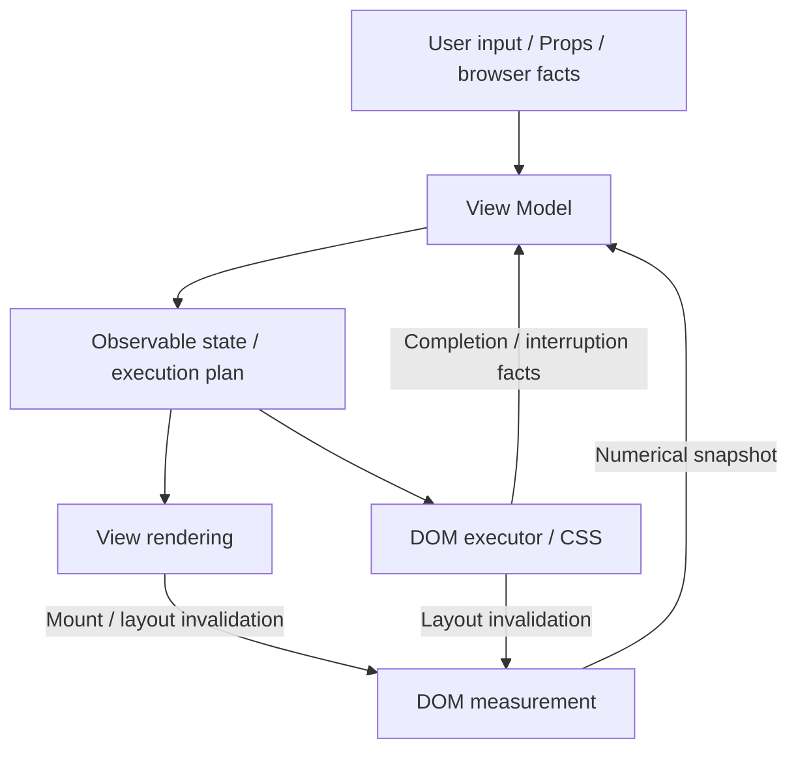

import { DocumentLayout } from '../../../component/Document/Layout';

<DocumentLayout active="approach" upstreamPath="getting-started/approach/">

# Approach

Understand the principles behind Idea React so you can compose, customize, and extend its
components without taking over their internal behavior. Start with the [installation guide][1]
for dependencies and stylesheets, then use this guide when building your own components.

## CSS

Idea React uses Bootstrap for its visual foundation and React with MobX for interactive behavior.
Keep styling, rendering, and business decisions separate rather than building a second styling
system or attaching a second JavaScript controller to the same component.

Prefer CSS custom properties for visual customization and Bootstrap utilities for layout,
spacing, typography, and responsive behavior. Keep remaining application styles in CSS Modules.
The library uses LESS internally, but does not expose a consumer-facing LESS customization API.
Future customization needs should be met with public CSS variables first.

Third-party component styles are not bundled into the library. Load Bootstrap, any required icon
font or widget stylesheet, and Idea React's own styles once in your document's shared head:

```html
<link
    rel="stylesheet"
    href="https://unpkg.com/bootstrap@6.0.0-alpha.1/dist/css/bootstrap.min.css"
/>
<link rel="stylesheet" href="https://unpkg.com/bootstrap-icons@1.13.2/font/bootstrap-icons.css" />
<link rel="stylesheet" href="https://unpkg.com/idea-react@next/dist/index.css" />
```

Only add optional third-party styles when your application uses the corresponding component.
Keep stylesheet versions aligned with the installed packages. Do not initialize Idea React
components with Bootstrap's JavaScript plugins: React and the component's model already own their
state and lifecycle.

### Examples

Override a Bootstrap token in your application's stylesheet instead of duplicating a component's
CSS rules:

```css
:root {
    --bs-border-radius: 0.75rem;
}
```

Compose public components and use their Props for component appearance. Reserve `className` for
utilities and your own styles rather than manually adding Bootstrap component classes:

```tsx
import { FC } from 'react';
import { Button, Stack } from 'idea-react';

export const Actions: FC = () => (
    <Stack className="gap-2" direction="horizontal">
        <Button variant="solid" theme="primary">
            Save
        </Button>
        <Button variant="outline" theme="secondary">
            Cancel
        </Button>
    </Stack>
);
```

## Modern essentials

### Responsive design

Build for small screens first, then add layout changes at larger breakpoints. Bootstrap 6 uses
prefix-responsive utilities such as `lg:d-flex`, not Bootstrap 5's suffix-responsive spelling.
Prefer the library's layout components when they express the same intent; see the [grid guide][2].

### HTML5 doctype and viewport

Use the HTML5 doctype and a responsive viewport. Framework applications should put the equivalent
metadata in their root layout rather than repeating it in individual components.

```html
<!doctype html>
<html lang="en">
    <head>
        <meta charset="utf-8" />
        <meta name="viewport" content="width=device-width, initial-scale=1" />
        <title>My Idea React application</title>
    </head>
    <body></body>
</html>
```

### Box sizing and Reboot

Bootstrap's global `border-box` sizing includes padding and borders in an element's declared
dimensions. Its Reboot styles normalize common HTML elements across browsers. Account for these
defaults when integrating an existing design; do not add another global reset without checking
how the two interact.

### Browser support

The Bootstrap 6 visual foundation depends on modern browser features. Check Bootstrap's
[browsers and devices guidance][3] alongside the requirements of React and any optional widgets
you use. Transpiling TypeScript or decorators does not polyfill browser APIs or CSS.

## Guiding principles

### Responsive by default

Keep content usable on narrow screens, with keyboard navigation and touch input. Preserve focus,
accessible names, and reduced-motion behavior when composing or extending interactive components.
Verify layouts in a real browser: a DOM test environment does not measure scrolling or responsive
geometry like a browser does.

### Composition and semantic HTML

Import public APIs from `idea-react`, not repository source paths or unpublished package
internals. Reuse an existing component before adding a wrapper with the same job.

Single-root components support `as` to change their root element or component while forwarding
the target's attributes. Preserve the original semantics, events, and capabilities when replacing
an element. For example, render a navigational action as a link rather than making a button
imitate one:

```tsx
import { FC } from 'react';
import { Button } from 'idea-react';

export const InstallLink: FC = () => (
    <Button as="a" href="../install/" variant="solid" theme="primary">
        Install Idea React
    </Button>
);
```

Fragments do not need an extra wrapper just to support `as`. A class component's ref refers to its
instance, not automatically to its root DOM element.

### Layering

Use the existing overlay components and their stacking conventions instead of competing with
arbitrarily large `z-index` values. CSS stacking contexts and clipping ancestors still matter;
test menus, dialogs, tooltips, and other overlays together.

### HTML and CSS before JavaScript

Use native elements for their semantics, anchors for navigation, and CSS for layout, stacking,
and static visual states. Do not create observable state just to reproduce something CSS already
expresses. Put browser-dependent interaction in the smallest client boundary and leave static
presentation server-renderable.

### Utilities before custom styles

Prefer [Bootstrap 6 utilities][4] to repeated CSS declarations. Keep remaining styles scoped with
CSS Modules, and use [Icon][5] with an appropriate font stylesheet instead of drawing a separate
icon component. Decorative icons should be hidden from assistive technology; icon-only controls
still need accessible names.

### Component and callback conventions

- Pass text through `children` rather than adding a second prop for the same content.
- Expose native form-control attributes at the component's top level; forward attributes you do
  not need to transform.
- Reuse existing prop types with `Pick`, `Omit`, or intersections. Use `PropsWithChildren` for
  content-bearing components.
- Give optional Props defaults in destructuring. Extract complicated JSX conditions and large
  rendering blocks into named values or focused rendering methods.
- Use arrow instance methods for React event handlers and pass compatible existing callbacks
  directly. Avoid creating forwarding closures during rendering.
- When a handler adds behavior, call the external callback first, then run the component's own
  logic. Use `(...) => unknown` when the external callback's return value is ignored.

## Component patterns

Choose the smallest pattern that fits the component. These are patterns for application-owned
components, not additional base classes you must introduce.

Stateful examples use MobX stage-3 decorators. Configure your compiler using the [Vite guide][6]
or the equivalent setup for your bundler; do not mix these examples with legacy decorators or
manual `makeObservable` initialization. In an RSC application, put `'use client'` at the top of
modules containing interactive class components, not around an otherwise static page tree.

### Props-only presentation

A function component is enough when rendering depends only on Props:

```tsx
import { FC, PropsWithChildren } from 'react';

export type GreetingProps = PropsWithChildren<{ className?: string }>;

export const Greeting: FC<GreetingProps> = ({ className = '', children }) => (
    <p className={className}>{children}</p>
);

Greeting.displayName = 'Greeting';
```

### Small local state

Keep a small amount of component-specific state on an observed class. There is no need to create
a separate model just to hold one counter:

```tsx
import { action, observable } from 'mobx';
import { observer } from 'mobx-react';
import { Component } from 'react';
import { Button } from 'idea-react';

@observer
export class LocalCounter extends Component {
    static displayName = 'LocalCounter';

    @observable
    accessor count = 0;

    @action
    increment = () => {
        this.count++;
    };

    render() {
        return <Button onClick={this.increment}>Count: {this.count}</Button>;
    }
}
```

### Model-backed behavior

Move cohesive business rules and reusable state into a model as the behavior grows. The View
creates or receives the model, renders observable values, and forwards interactions:

```tsx
import { action, observable } from 'mobx';
import { observer } from 'mobx-react';
import { Component } from 'react';
import { Button } from 'idea-react';

export class CounterModel {
    @observable
    accessor count = 0;

    @action
    increment = () => {
        this.count++;
    };
}

@observer
export class ModelCounter extends Component {
    static displayName = 'ModelCounter';

    store = new CounterModel();

    render() {
        const { store } = this;

        return <Button onClick={store.increment}>Count: {store.count}</Button>;
    }
}
```

An event method that only forwards to a model action does not need another action boundary.
After `await`, however, subsequent observable updates need their own action: call a separate
action method or an `action()`-wrapped instance function. An action before `await` does not cover
the continuation.

### Prop reactions and event delegation

When behavior must react to changing Props, `ObservedComponent` and its `@reaction` decorator
from [MobX React helper][7] provide observable Props and lifecycle-managed reactions. Add the
helper as a direct application dependency if you use it:

```sh
pnpm add mobx-react-helper
```

This example resets local selection when `resetKey` changes. One table handler delegates clicks
to semantic buttons, so keyboard activation continues to work without per-row event closures:

```tsx
import { action, observable } from 'mobx';
import { observer } from 'mobx-react';
import { ObservedComponent, reaction } from 'mobx-react-helper';
import { MouseEvent } from 'react';
import { Button, Table } from 'idea-react';

export interface ChoiceTableProps {
    resetKey: string;
    onSelect?: (value: string) => unknown;
}

@observer
export class ChoiceTable extends ObservedComponent<ChoiceTableProps> {
    static displayName = 'ChoiceTable';

    @observable
    accessor selected = '';

    @reaction(({ observedProps: { resetKey } }) => resetKey)
    @action
    resetSelection() {
        this.selected = '';
    }

    @action
    select = (value: string) => {
        this.selected = value;
    };

    handleClick = ({ target, currentTarget }: MouseEvent<HTMLTableElement>) => {
        if (!(target instanceof Element)) return;

        const button = target.closest<HTMLButtonElement>('button[data-choice]');
        const { choice } = button?.dataset || {};
        if (!choice) return;

        this.props.onSelect?.(choice);

        this.select(choice);
    };

    renderChoice = (value: string) => (
        <tr key={value}>
            <td>
                <Button data-choice={value} active={this.selected === value}>
                    {value}
                </Button>
            </td>
        </tr>
    );

    render() {
        return (
            <Table onClick={this.handleClick}>
                <caption>Choose an item</caption>
                <tbody>{['One', 'Two', 'Three', 'Four'].map(this.renderChoice)}</tbody>
            </Table>
        );
    }
}
```

Read `observedProps` inside reactive derivations. If you override the helper's lifecycle methods,
call the superclass methods so its synchronization and cleanup still run.

## Complex component architecture

Use MVC, MVVM, or MVP as a guide to responsibilities, not as a requirement to add layers.
For a complex interactive component, make a cohesive View Model the business hub:

| Part               | Owns                                                                                                 | Does not own                                                     |
| ------------------ | ---------------------------------------------------------------------------------------------------- | ---------------------------------------------------------------- |
| View               | Model creation and prop synchronization, rendering, input forwarding, lifecycle wiring               | Business policy, page selection, asynchronous business workflows |
| View Model / Store | Business rules, asynchronous workflows, numerical calculations, observable state and execution plans | DOM access, layout measurement, browser event registration       |
| DOM adapter        | Numerical layout snapshots, requested DOM effects, measurement and completion feedback               | Querying the entire model or choosing business state             |

### One-way state and operation flow



`observer` renders display state. A MobX `reaction` can consume an execution plan and request a
DOM effect. The adapter reports facts through explicit callbacks, which become the next model
input; it does not obtain the whole Store and make a competing business decision.

Prefer reusing framework composition, decorators, or an existing model to scattering the same
behavior across event handlers and Hooks. Pure functions are appropriate for focused, stateless
transformations, not as a replacement for cohesive business models.

### Measurement and execution

An application-owned adapter might expose a numerical snapshot and accept a data-only plan:

```ts
export interface LayoutSnapshot {
    positions: readonly number[];
    maximum: number;
}

export interface MotionPlan {
    left: number;
    smooth: boolean;
}
```

The model decides which position is reachable and whether movement is appropriate. The adapter
measures elements and performs the requested browser operation; it does not choose the active
item. Measurement and execution can share an ordinary class with distinct methods instead of
requiring a new class for each responsibility.

For example, [Carousel][8] turns layout measurements into reachable pages and chooses its
loop, wrap, or stop behavior in its model. A state-observed motion plan drives its DOM executor.
Fade mode instead uses rendered state and CSS. Application code uses the public Carousel API;
its internal measurement and animation classes are not extra package entry points.

Measure after mount, before a transition, or when layout is invalidated, and reuse snapshots.
Interrupt and remeasure when necessary rather than interleaving layout reads and writes every
frame. An executor or CSS can animate between state changes without forcing React to rerender
on every animation frame.

### Lifecycle and asynchronous work

- Initialize declarative state and disposer fields with class properties. Start browser effects
  only after client mount, not in constructors or server rendering.
- Dispose reactions, observers, listeners, timers, and animation resources on unmount.
- When replacing a model or changing modes, release old effects and preserve relevant selection
  and playback intent. Unrelated Props changes should not restart a valid timer or subscription.
- Check that the instance and current operation are still valid before applying an asynchronous
  result; an old completion must not overwrite newer state or reconnect a destroyed instance.
- Let errors propagate unless the application has meaningful recovery. Centralize unhandled
  asynchronous error reporting at the application root, with listener registration and removal
  tied to its lifecycle.
- Use `finally` for resource release or loading-state reset, not to swallow failures. Updates
  after asynchronous work still need an action boundary.

Keep numerical model rules independently testable. Use real-browser checks for layout,
keyboard and touch interaction, reduced motion, interruption, and cleanup. The goal is fewer
duplicated decisions and clearer ownership, not the fewest files or an abstraction for every mode.

## Community

Join the project's [GitHub Discussions][9] to ask questions, exchange ideas, and discuss
improvements. For related libraries and application starters, explore the [ecosystem guide][10]. Keep application
extensions outside library internals so they can evolve without depending on unpublished paths.

</DocumentLayout>

[1]: ../install/
[2]: ../../layout/grid/
[3]: https://getbootstrap.com/docs/6.0/getting-started/browsers-devices/
[4]: https://getbootstrap.com/docs/6.0/utilities/
[5]: ../../extensions/icon/
[6]: ../vite/
[7]: https://github.com/idea2app/MobX-React-helper
[8]: ../../components/carousel/
[9]: https://github.com/idea2app/Idea-React/discussions
[10]: ../ecosystem/
